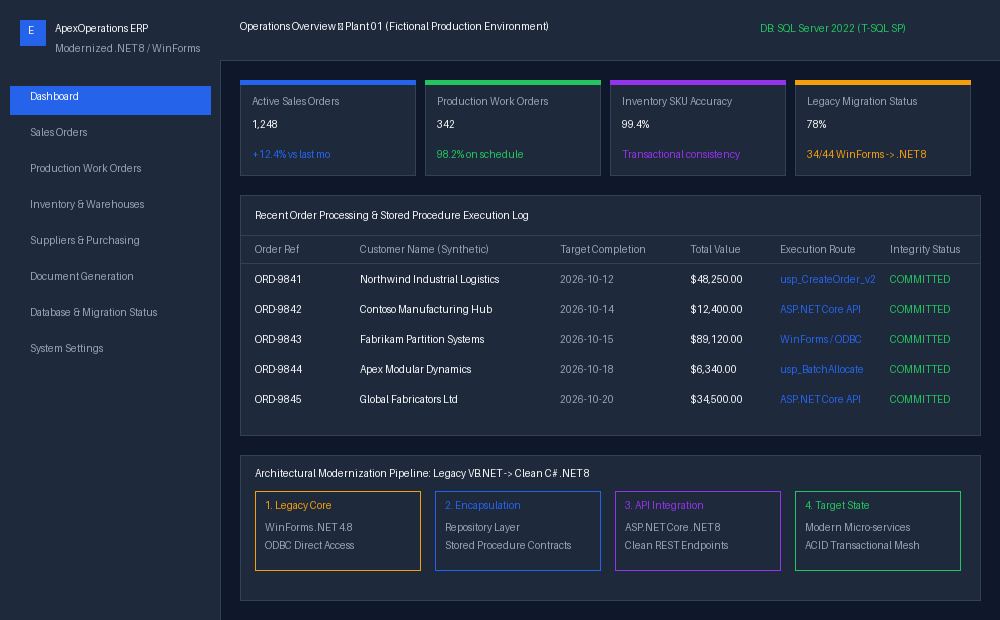
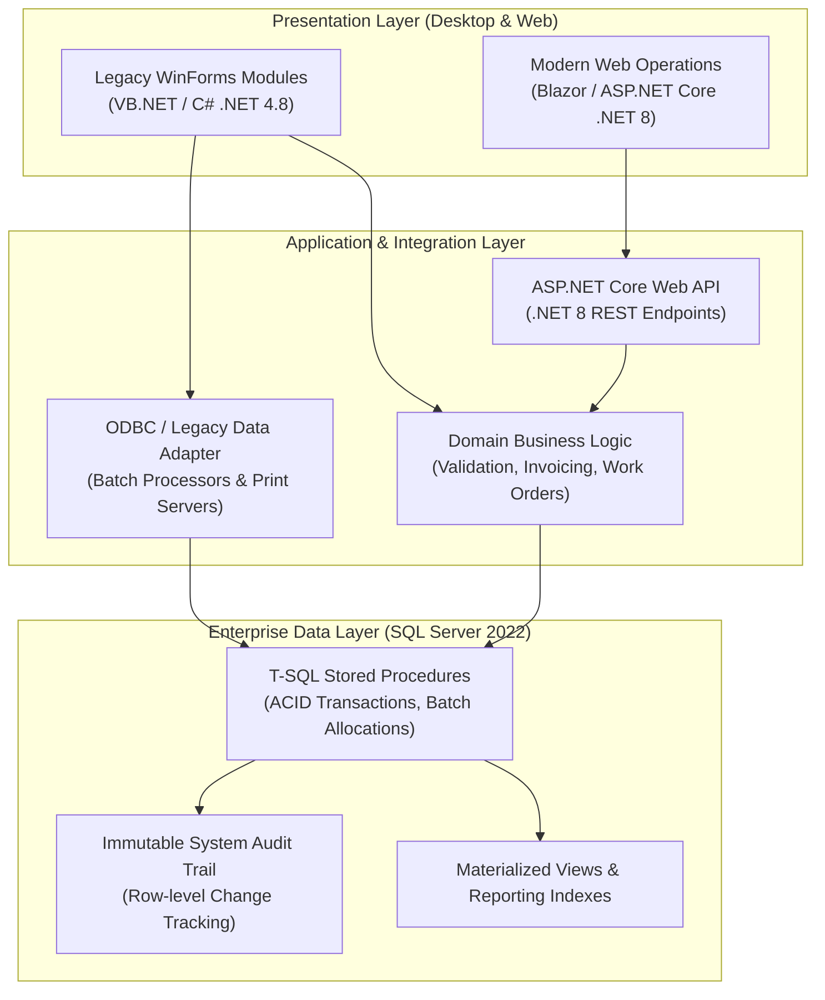

# Enterprise Operations Platform — Architecture & Modernization Showcase

> **Demonstrating full-lifecycle enterprise engineering: transactional data consistency, progressive legacy migration (.NET Framework / VB.NET / WinForms to .NET 8 / C#), and high-throughput SQL Server architectures.**

---

## 🏢 Executive Overview & Engineering Narrative

In large-scale industrial and manufacturing environments, software systems must guarantee continuous uptime, strict ACID transactional semantics, and millisecond database execution times. Real enterprise codebases frequently combine:
- Decades of hardened business logic in **VB.NET and C# WinForms desktop clients**.
- High-performance database engines powered by **SQL Server, T-SQL Stored Procedures, and ODBC/ADO.NET drivers**.
- A strategic requirement for **zero-downtime modernization** toward **ASP.NET Core REST APIs and modern .NET 8 micro-services**.

> **Confidentiality & IP Notice:**  
> This showcase represents architectural patterns, domain modeling, and migration methodologies derived from real-world enterprise ERP engineering (e.g. *Citrino ERP* and manufacturing systems). To strictly protect client intellectual property and commercial confidentiality, **all code, schemas, entity names, stored procedures, and UI elements in this repository are 100% synthetic**.

---

## 🖥️ Operational System Mockup

  
   
  <em>Figure 1: Architectural UI mockup of the synthetic "ApexOperations ERP" desktop/web monitoring bridge.</em>

---

## 🏛️ Enterprise Multi-Tier Architecture

---

## 🔄 Legacy Modernization Strategy (Keeping While Evolving)

A frequent enterprise error is attempting high-risk "big bang" rewrites. This showcase demonstrates the **Strangler Fig & Incremental Encapsulation Pattern**:

1. **Step 1: Direct ODBC / Dataset Encapsulation:**  
   Replace scattered raw SQL strings embedded in legacy WinForms code with strongly typed Repository abstractions and parameterized stored procedures.
2. **Step 2: Shared .NET Standard / .NET 8 Domain Libraries:**  
   Extract pure domain rules (e.g., invoice total calculations, tax rules, inventory reservation logic) into shared class libraries usable by both .NET Framework 4.8 and .NET 8.
3. **Step 3: Edge API Exposure:**  
   Deploy an ASP.NET Core gateway alongside legacy services, directing new client requests and external integrations through REST endpoints while legacy desktop terminals continue uninterrupted.
4. **Step 4: Database Contract Stability:**  
   Maintain backward-compatible T-SQL stored procedures using default parameter values and view abstractions so legacy desktop clients and modern APIs query the same database concurrently.

---

## 📊 Core Business Domains Demonstrated

| Domain | Business Rules & Invariants | Data Engineering Strategy |
|---|---|---|
| **Sales & Orders** | Strict validation of customer credit limits, payment terms, and delivery schedules before order confirmation. | Atomic transaction wrapping order headers, lines, and credit ledger. |
| **Manufacturing Work Orders** | Routing steps (Cutting, Assembly, Quality Control), worker allocations, bill-of-materials explosion. | Optimized stored procedures with table-valued parameters (`TVP`) for fast batch inserts. |
| **Inventory & Warehouses** | Real-time multi-bin inventory tracking, lot traceability, and allocation locking. | Optimistic concurrency controls (`ROWVERSION` / timestamp) to prevent double-allocation race conditions. |
| **Purchasing & Suppliers** | Supplier quotation comparison, purchase order authorization workflows, goods receipt reconciliation. | Audit logging capturing authorizer ID, timestamps, and line variance. |
| **Logistics & Documents** | Automated generation of packing slips, CMR transport notes, and customer invoices. | Asynchronous background queuing via dedicated integration services. |

---

## 🛡️ Data Integrity & Concurrency Controls

- **Optimistic Concurrency:** Every critical table implements `SysStartTime`, `SysEndTime` (temporal tables) or `ROWVERSION` to detect concurrent write conflicts.
- **Deadlock Mitigation:** Standardized query access patterns across all stored procedures (accessing tables in consistent topological order) eliminate SQL Server deadlocks during peak shifts.
- **Auditing by Design:** Triggers and stored procedures write every financial, status, and inventory change to a centralized, append-only `AuditEvents` partition.

---

## 📁 Showcase Repository Contents

- [`docs/architecture.md`](docs/architecture.md): Deep-dive into layer boundaries and data contracts.
- [`docs/migration-guide.md`](docs/migration-guide.md): Practical steps for migrating VB.NET WinForms to modern C# ASP.NET Core.
- [`docs/data-consistency.md`](docs/data-consistency.md): Locking patterns, isolation levels (Read Committed Snapshot), and stored procedure standards.
- [`demo/mock/`](demo/mock/): Synthetic T-SQL stored procedures and C# service models demonstrating clean enterprise code.

---

## 📄 Licensing & Transparency Notice

This repository is a public showcase of a proprietary enterprise software project. The source code of the actual application is not included. All rights reserved unless explicitly stated otherwise. See [`LICENSE`](LICENSE) for terms.

> **About:** This repository serves exclusively as an architectural and engineering portfolio showcase. Proprietary business logic, client schemas, internal endpoints, and corporate IP are strictly protected. All database objects, schemas, DTOs, and dashboard mockups are 100% synthetic creations designed for technical presentation.
