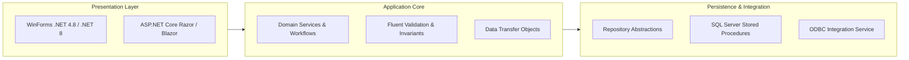

# Enterprise Platform Architecture

## Layered Design & Separation of Concerns

The architecture follows strict hexagonal/clean layering principles adapted for high-throughput enterprise operations:

### 1. Presentation Layer
- **Legacy Desktop Terminals:** Windows Forms interfaces optimized for keyboard-only warehouse input, barcode scanner events, and instant local printing.
- **Modern Management Portal:** Web-based operational dashboard for plant supervisors to monitor throughput and approval gates.

### 2. Application Core
- Contains pure business logic, tax calculation rules, discount authorization workflows, and production step sequencing.
- Zero dependencies on SQL Server or UI frameworks, making domain logic 100% testable via xUnit/NUnit.

### 3. Persistence Layer
- Encapsulates database access behind clean repository interfaces (`IOrderRepository`, `IInventoryRepository`).
- Critical batch operations (e.g., allocating 500 components across 20 active work orders) execute via optimized T-SQL stored procedures to minimize network roundtrips.
