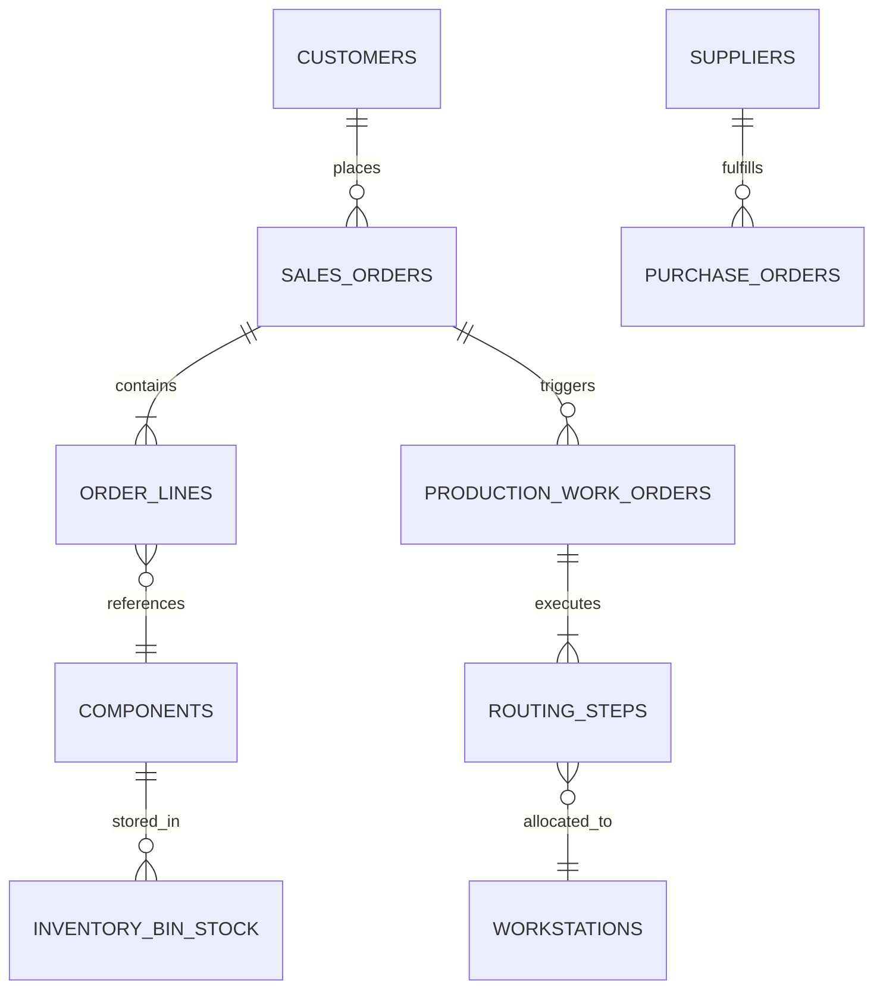

# Synthetic ERP Domain Model

## Core Entities & Relationships

The synthetic `ApexOperations ERP` domain covers the complete lifecycle from commercial order quotation to manufacturing delivery:

## Entity Invariants
1. **SalesOrder:** Cannot transition to `Dispatched` until all associated `ProductionWorkOrders` have status `Completed` and QA sign-off.
2. **InventoryBinStock:** Quantity available = `QuantityOnHand - QuantityAllocated`. Quantity available must never be negative.
3. **RoutingStep:** Steps must execute strictly in ascending `SequenceNumber` order (e.g. 10: Laser Cut -> 20: CNC Bend -> 30: Powder Coat -> 40: Final Assembly).
